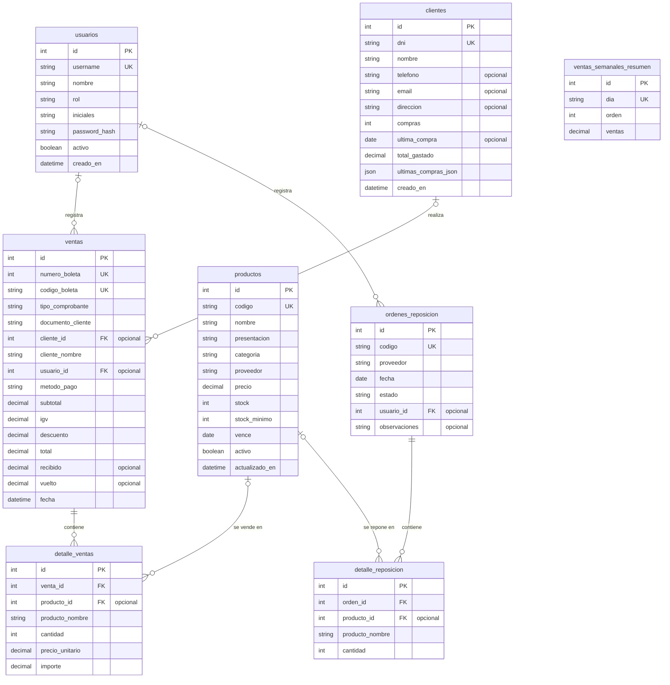

# Nova Salud

Sistema web de gestión para la botica **Nova Salud**. Permite administrar las ventas del mostrador, el inventario, los clientes y las órdenes de reposición desde una sola aplicación. Está pensado como herramienta interna: quien la usa es el personal que atiende en el local.

**Demo:** [nova-salud-steel.vercel.app](https://nova-salud-steel.vercel.app)

> Proyecto académico desarrollado como trabajo final del curso **Fullstack Developer Software** (SENATI). Tema: *Implementación de un software web de gestión de inventario y venta de una botica*.

---

## El problema

La botica "Nova Salud" está en una zona comercial con mucha demanda de medicamentos. Su crecimiento trajo problemas porque el control de stock y la atención se hacían de forma manual:

- Errores en el inventario.
- Desabastecimientos frecuentes.
- Tiempos de espera largos para los clientes.

## La solución

Una aplicación web que centraliza la operación del local:

- Registra ventas de forma rápida, con búsqueda por nombre o código.
- Mantiene el inventario actualizado y avisa cuando un producto tiene stock bajo, está agotado o está por vencer.
- Guarda el historial de compras de cada cliente.
- Gestiona la reposición de productos agrupada por proveedor.
- Protege el acceso con inicio de sesión.

---

## Pantallas y funcionalidades

| Pantalla | Qué hace |
| --- | --- |
| **Inicio de sesión** | Acceso protegido. La API usa autenticación con JWT. |
| **Dashboard** | Resumen de ventas, alertas de stock, productos por vencer y ventas semanales. |
| **Ventas** | Punto de venta: búsqueda por nombre o código, carrito, cálculo de IGV (18 %), descuentos, métodos de pago y registro de comprobantes. |
| **Inventario** | Consulta, búsqueda y filtros de productos, con alertas por bajo stock, agotados y próximos a vencer. |
| **Clientes** | Consulta de datos e historial de compras. |
| **Reposición** | Creación de órdenes agrupadas por proveedor y recepción de pedidos con actualización de stock. |

---

## Tecnologías

**Frontend**
- [React](https://react.dev) 19 y [Vite](https://vite.dev) 8
- [React Router](https://reactrouter.com) 7
- [Recharts](https://recharts.org), [Bootstrap](https://getbootstrap.com) y [Lucide React](https://lucide.dev)

**Backend y datos**
- Node.js y [Express](https://expressjs.com) 5
- SQLite integrado para desarrollo y caché local
- Supabase (PostgreSQL) como almacenamiento remoto opcional
- JWT (`jsonwebtoken`) y `bcryptjs` para autenticación y contraseñas

**Despliegue:** [Vercel](https://vercel.com)

---

## Requisitos

- Node.js **22.5 o superior** y npm.
- Una instancia de Supabase es **opcional**. Sin configurarla, la API usa SQLite local y crea `server/novasalud.db` automáticamente.

## Instalación y ejecución local

```bash
git clone https://github.com/Magidark00/NovaSalud.git
cd NovaSalud
npm install
```

En una terminal, inicia la API:

```bash
npm run server
```

En otra terminal, inicia la interfaz:

```bash
npm run dev
```

Abre la URL que muestra Vite, normalmente `http://localhost:5173`. La API local se ejecuta en `http://localhost:3001` y su endpoint de estado es `/api/health`.

### Configuración opcional de Supabase

La API detecta Supabase cuando están definidas `SUPABASE_URL` y `SUPABASE_KEY`. Puedes definirlas en el entorno antes de iniciar el servidor. `SUPABASE_KEY` puede ser una clave con permisos adecuados para las operaciones que realiza la API. **No publiques claves secretas ni las incluyas en el repositorio.**

El esquema y los datos de ejemplo para PostgreSQL están en [`server/supabase_schema.sql`](server/supabase_schema.sql).

> ⚠️ El script elimina y vuelve a crear las tablas existentes. Ejecútalo únicamente en una base de datos de desarrollo cuyos datos puedas reemplazar.

## Scripts

| Comando | Descripción |
| --- | --- |
| `npm run dev` | Inicia el servidor de desarrollo de Vite. |
| `npm run server` | Inicia la API Express local. |
| `npm run build` | Genera la compilación de producción en `dist/`. |
| `npm run preview` | Sirve localmente la compilación de producción. |
| `npm run lint` | Ejecuta ESLint. |

---

## API

La API ofrece rutas para autenticación, dashboard, productos, ventas, clientes y reposición. Las rutas principales están bajo `/api`:

| Recurso | Rutas |
| --- | --- |
| Sesión | `/api/auth/login`, `/api/auth/me` |
| Dashboard | `/api/dashboard` |
| Productos | `/api/productos` |
| Ventas | `/api/ventas` |
| Clientes | `/api/clientes` |
| Reposición | `/api/reposicion` |
| Estado | `/api/health` |

Las rutas que requieren sesión reciben el token JWT en el encabezado:

```
Authorization: Bearer <token>
```

---

## Modelo de datos



> Los tipos del diagrama son ilustrativos. El esquema SQL completo, con restricciones, relaciones y datos iniciales, está en [`server/supabase_schema.sql`](server/supabase_schema.sql).

**Relaciones principales**

- Un cliente y un usuario pueden asociarse a muchas ventas, y cada venta contiene líneas en `detalle_ventas`, que pueden apuntar a productos.
- Una orden de reposición agrupa sus líneas en `detalle_reposicion`, que pueden referenciar productos.
- Las referencias opcionales conservan el registro aunque se elimine el cliente, el usuario o el producto asociado.
- `ventas_semanales_resumen` guarda el total por día que alimenta el gráfico del Dashboard.

---

## Estructura del proyecto

```text
NovaSalud/
├── api/                  Adaptador de API para despliegue serverless
├── public/               Recursos estáticos
├── server/
│   ├── middleware/       Seguridad y autenticación
│   ├── routes/           Rutas de la API
│   ├── app.js            Configuración de Express
│   ├── db.js             SQLite y datos iniciales
│   └── supabase_schema.sql
└── src/
    ├── componentes/      Componentes de interfaz por módulo
    ├── context/          Estado compartido y sesión
    ├── pages/            Pantallas de la aplicación
    ├── services/         Comunicación con la API
    └── utils/            Formato y exportación
```

> Los nombres de carpetas y archivos **distinguen mayúsculas y minúsculas**. En Windows funciona igual, pero Vercel corre en Linux y falla si no coinciden exactamente.

---

## Seguridad

- Las rutas protegidas exigen un token JWT válido.
- Las contraseñas se guardan cifradas (`password_hash`, generado con `bcryptjs`).
- Las claves de Supabase se definen como variables de entorno y no se incluyen en el repositorio.

---

## Despliegue

El repositorio incluye configuración para Vercel (`vercel.json`). Configura las variables de entorno necesarias para el backend en el proyecto de despliegue.

Para que los datos se conserven entre ejecuciones, configura Supabase. El archivo SQLite local o temporal no es almacenamiento persistente en un entorno serverless.

---

## Estado del proyecto

- [x] Diseño de las 5 pantallas en Figma
- [x] Dashboard, Ventas, Inventario, Clientes y Reposición
- [x] API REST con Express y autenticación JWT
- [x] Base de datos con SQLite local y Supabase (PostgreSQL) opcional
- [x] Despliegue en Vercel

---

## Equipo

- Matias Melendez Asencio
- Alejandro Cruz Llocya
- Josue del Rio Montoya
- Jesus Cumpally Alanoca
- Renato Ramos Rojas

---

## Licencia

Proyecto académico con fines educativos.
