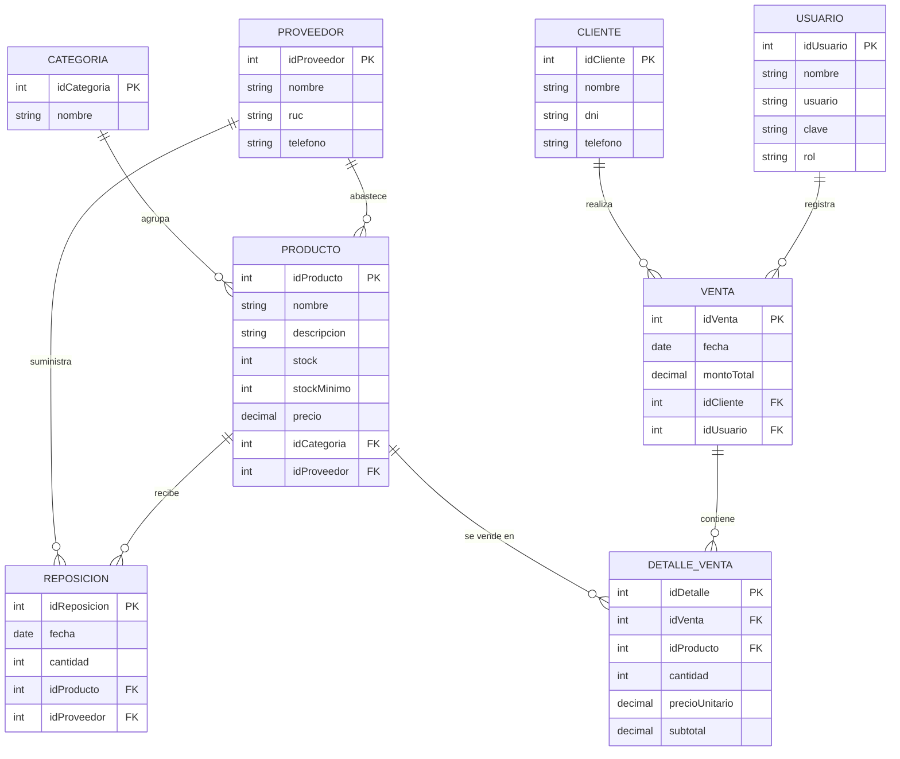

# Nova Salud

Sistema web para gestionar de forma centralizada el **inventario, las ventas y la atención al cliente** de una botica. Está pensado como herramienta interna para los trabajadores del local: el cliente nunca entra al sistema, quien lo usa es la persona que atiende en el mostrador.

**Demo:** [nova-salud-steel.vercel.app](https://nova-salud-steel.vercel.app)

> Trabajo final del curso **Fullstack Developer Software** (SENATI) · Tema: *Implementación de un software web de gestión de inventario y venta de una botica*.

---

## El problema

La botica "Nova Salud" está en una zona comercial con mucha demanda de medicamentos. Su crecimiento trajo problemas porque el control de stock y la atención se hacen de forma manual:

- Errores en el inventario.
- Desabastecimientos frecuentes.
- Tiempos de espera largos para los clientes.

## La solución

Una aplicación web que permite:

- Registrar ventas de forma rápida, con búsqueda o escaneo de código de barras.
- Mantener el stock actualizado automáticamente con cada venta.
- Recibir alertas de reposición cuando un producto tiene stock bajo, está agotado o está por vencer.
- Consultar el historial de compras de cada cliente.
- Gestionar la reposición de productos por proveedor.

---

## Pantallas y funcionalidades

| Pantalla | Qué hace |
| --- | --- |
| **Dashboard** | Resumen del día: ventas, productos con stock bajo, por vencer y agotados, gráfico de ventas de la semana, alertas de reposición y últimas ventas. |
| **Ventas** | Punto de venta. Búsqueda por nombre o código, filtro por categoría, ticket con cantidades, IGV (18 %), descuento, métodos de pago (Efectivo, Tarjeta, Yape y Plin), cálculo de vuelto y emisión de boleta. Al cobrar descuenta el stock. |
| **Inventario** | Lista de productos con búsqueda, filtros por categoría, proveedor y estado, paginación y tarjetas de resumen. Cada producto tiene un estado: *Normal*, *Stock bajo*, *Por vencer* (vence en 90 días o menos) o *Agotado*. |
| **Clientes** | Lista de clientes con búsqueda por nombre o DNI, detalle del cliente seleccionado, últimas compras y botón **Nueva venta**, que abre Ventas con el cliente ya elegido. |
| **Reposición** | Productos que hay que reponer con una cantidad sugerida, armado de la orden agrupada por proveedor, generación de la orden y seguimiento de pedidos (*Pendiente* / *Recibida*). Al recibir un pedido, el stock sube. |

### Cómo se calculan algunas cosas

- **IGV:** los precios del inventario ya incluyen el IGV (18 %). El subtotal y el IGV se calculan hacia atrás a partir del total.
- **Cantidad sugerida de reposición:** se pide lo necesario para llegar al doble del stock mínimo (el triple si el producto está agotado), redondeado a múltiplos de 5.
- **Estado compartido:** Ventas, Inventario y Reposición usan los mismos datos. Si vendes un producto, baja el stock en Inventario y puede aparecer en Reposición.

---

## Tecnologías

**Frontend**
- [React](https://react.dev) 19 con [Vite](https://vite.dev)
- [React Router](https://reactrouter.com) para la navegación entre pantallas
- [Recharts](https://recharts.org) para el gráfico de ventas
- [lucide-react](https://lucide.dev) para los íconos
- CSS propio por componente
- ESLint

**Backend**
- Node.js (versión 22.5 o superior) con [Express](https://expressjs.com) 5
- Autenticación con JSON Web Tokens (`jsonwebtoken`) y contraseñas cifradas con `bcryptjs`
- `cors` para permitir las peticiones desde el frontend

**Despliegue:** [Vercel](https://vercel.com)

---

## Cómo ejecutarlo

Requisitos: **Node.js 22.5 o superior** y npm.

```bash
# 1. Clonar el repositorio
git clone https://github.com/Magidark00/NovaSalud.git
cd NovaSalud

# 2. Instalar dependencias
npm install

# 3. Levantar el frontend
npm run dev
```

La aplicación queda disponible en `http://localhost:5173`.

Para levantar el backend, en otra terminal:

```bash
npm run server
```

### Scripts disponibles

| Comando | Descripción |
| --- | --- |
| `npm run dev` | Servidor de desarrollo del frontend |
| `npm run server` | Servidor del backend (API) |
| `npm run build` | Compila el frontend para producción |
| `npm run preview` | Vista previa de la compilación |
| `npm run lint` | Revisa el código con ESLint |

---

## Estructura del proyecto

```
NovaSalud/
├── public/
├── src/
│   ├── main.jsx                 Punto de entrada
│   ├── App.jsx                  Rutas de la aplicación
│   ├── index.css                Variables de color y estilos globales
│   ├── context/                 Estado compartido (productos y reposiciones)
│   ├── hooks/                   useVenta: carrito, totales, IGV y vuelto
│   ├── utils/formato.js         Formato de soles, fechas, estados de producto
│   ├── data/                    Datos de ejemplo (se reemplazan por la API)
│   ├── pages/                   Dashboard, Ventas, Inventario, Clientes, Reposicion
│   └── componentes/
│       ├── layout/              Barra lateral, barra superior y estructura general
│       ├── common/              Componentes reutilizables (etiquetas, tarjetas, tablas, paginación)
│       ├── dashboard/
│       ├── ventas/
│       ├── inventario/
│       ├── clientes/
│       └── reposicion/
├── index.html
├── package.json
└── vite.config.js
```

> Los nombres de carpetas y archivos **distinguen mayúsculas y minúsculas**. En Windows funciona igual, pero Vercel corre en Linux y falla si no coinciden exactamente.

---

## Modelo de datos



### Campos que las pantallas ya usan y el modelo aún no tiene

| Tabla | Campo | Para qué sirve |
| --- | --- | --- |
| `Producto` | `fechaVencimiento` | Estado "Por vencer" y columna "Vence" |
| `Producto` | `presentacion` | Texto como "Caja x 100" |
| `Producto` | `codigoBarras` | Escaneo en Ventas |
| `Venta` | `metodoPago` | Efectivo, Tarjeta, Yape o Plin |
| `Venta` | `numeroBoleta`, `igv` | Boleta (B001-000461) y desglose del IGV |
| `Reposicion` | `estado` | Pendiente o Recibida |

---

## Estado del proyecto

- [x] Diseño de las 5 pantallas en Figma
- [x] Dashboard
- [x] Ventas
- [x] Inventario
- [x] Clientes
- [x] Reposición
- [x] Estado compartido entre pantallas (datos de ejemplo)
- [ ] Conectar el frontend con la API y la base de datos
- [ ] Inicio de sesión y permisos por rol (Administrador / Vendedor)
- [ ] Formularios de nuevo y edición de productos y clientes
- [ ] Exportar listas a CSV / Excel
- [ ] Historial de ventas y de reposiciones
- [ ] Nueva reposición manual
- [ ] Datos del Dashboard calculados desde la base de datos

---

## Seguridad y buenas prácticas previstas

- Contraseñas cifradas (`bcryptjs`) y sesiones con JWT.
- El backend debe **recalcular el total y el IGV** al registrar una venta, sin confiar en lo que envía el navegador.
- El número de boleta lo asigna el backend, para evitar duplicados.
- El descuento de stock y la recepción de pedidos se hacen en el backend.

---

## Equipo

- Matias Melendez Asencio
<!-- Agrega aquí a tus compañeros -->

---

## Licencia

Proyecto académico desarrollado con fines educativos.
